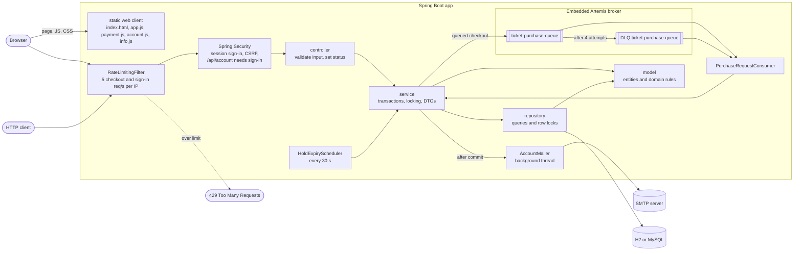
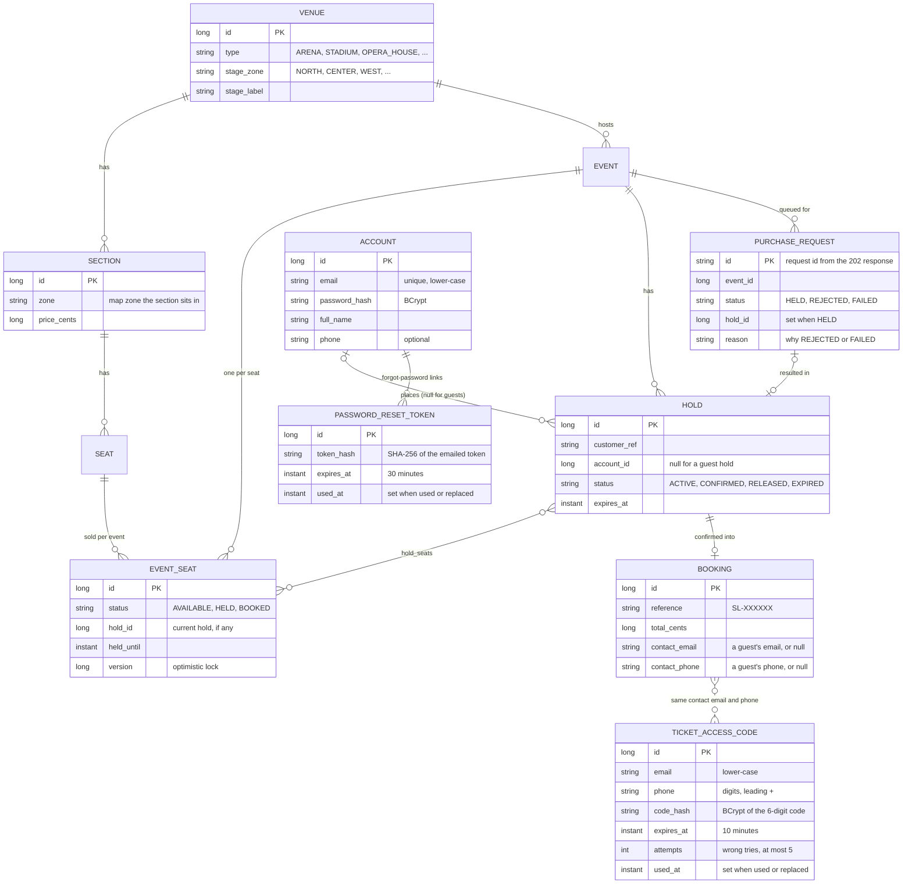
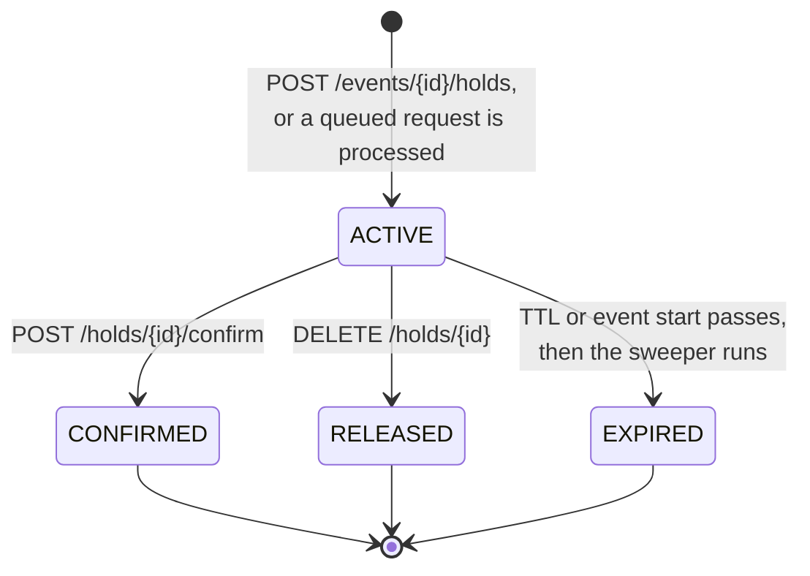
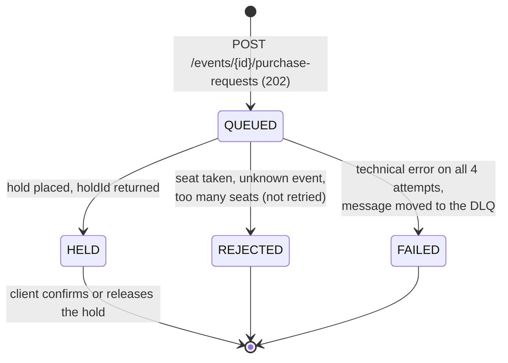
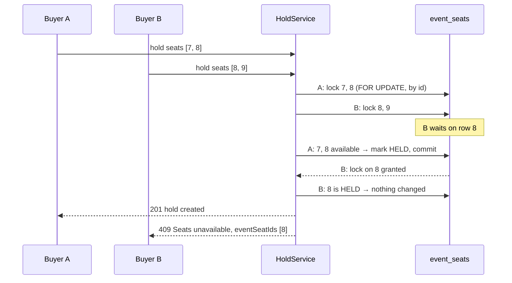
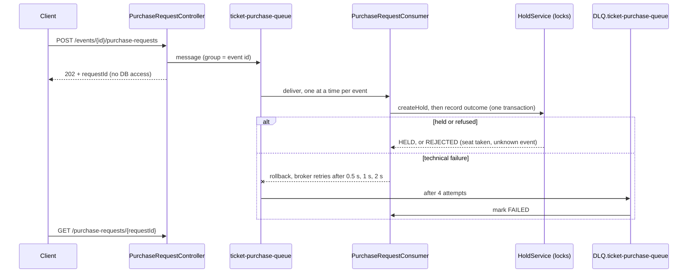

# SeatLock architecture

This guide explains how SeatLock is put together and why it can never sell one seat twice. For
endpoint details see [API.md](API.md); for setup see the [README](../README.md).

## Layers

The web client in `src/main/resources/static` is plain HTML, CSS and JavaScript served by
Spring Boot at `/`. It has no server-side logic: it calls the same public REST API as any other
client, so every seat it shows and every hold it places goes through the same checks. Its home
page (Today's concerts, Tomorrow's concerts and Selling fast blocks, each opening a list) is built in the browser from `GET /api/events`, whose seat
totals come from one grouped count over `event_seats` (`EventSeatRepository.countSeatsByEvent`);
it reads without locks, so the numbers can be a moment old, which is fine for a show list.

A request passes the rate limiter (checkout and sign-in paths only), then Spring Security, then a
thin controller, then a service that owns the transaction.

**Accounts** are optional. Spring Security identifies a signed-in buyer by the session cookie and
leaves everything open to guests except `/api/account/**`. A request is CSRF-checked only when it
carries a session cookie, because only then could a forged request act as someone; the web client
echoes the `XSRF-TOKEN` cookie in an `X-XSRF-TOKEN` header. Controllers pass the signed-in
account id (or null for a guest) to the services, which tie new holds to it and refuse anyone else
on that hold with `404`.

**Emails** (welcome, reset link, password changed; the ticket email and the Find my tickets code
sent by `BookingMailer`) are published as events inside the service's transaction and sent only
after it commits, on a background thread. The ticket email is HTML with a plain-text alternative;
its QR code (drawn by `QrCodeGenerator` with ZXing, holding the booking reference) is an inline
image the HTML shows as `cid:ticket-qr`. With no mail server, `EmailSender` hands emails to the
`DemoOutbox` when it is on (the `demo` profile), where `/outbox.html` shows them to the local
machine only, and otherwise skips them with a warning that names only the subject. Nothing is
sent for a change that rolled back, a slow mail server never delays a response, and response
times do not reveal whether an email has an account.

**Find my tickets** (`TicketAccessService`) lets a guest see their tickets again: the email and
phone number they paid with get a 6-digit code by email (`TicketAccessCode`, BCrypt-hashed, one
use, 10 minutes, 5 wrong tries, a new code at most every 30 seconds), and the code returns their
guest bookings as tickets. Asking for a code answers `202` and does the same hashing work whether
or not bookings match, so neither the answer nor its timing reveals who has booked. Checking a
code locks its row, so two checks at once cannot both use it or both escape the wrong-try count.

There are two ways to place a hold:

- **Direct** (`POST /api/events/{id}/holds`): the service locks the seats and answers `201` or
  `409` in the same request.
- **Queued** (`POST /api/events/{id}/purchase-requests`): the service only puts a message on the
  queue and answers `202`. The consumer later calls the same `HoldService.createHold`, so both
  paths share one set of locking rules.

| Layer | Package | Responsibility |
|---|---|---|
| Controller | `controller` | Validates the request (`@Valid`), calls one service method, sets status and `Location`. No logic. |
| Service | `service` | Owns transactions, takes locks in the right order, calls entity methods, returns DTO records. |
| Repository | `repository` | Spring Data interfaces, including the `FOR UPDATE` locking queries. |
| Model | `model` | JPA entities. Domain rules live here (`EventSeat.hold/book/releaseIfHeldBy`, `Hold.confirm/release/expire`). |
| DTO | `dto` | Request and response records. Entities never leave a service (`open-in-view` is off). |
| Errors | `exception` | Domain exceptions, mapped to RFC 9457 responses in `GlobalExceptionHandler`. |
| Queue | `queue` | Artemis queue names, retry and dead-letter policy, JSON messages, and `PurchaseRequestConsumer`. |
| Rate limit | `ratelimit` | `RateLimitingFilter`: a token bucket per client IP on the checkout and sign-in paths; returns `429` before any controller runs. |
| Security | `security` | `SecurityConfig` (which paths need sign-in, CSRF rule, BCrypt), `SessionAuthenticator` (sign in and out of the HTTP session), `AccountPrincipal`. |
| Notification | `notification` | Email events; `AccountMailer` and `BookingMailer` (after commit, in the background); `EmailSender` (SMTP, HTML with inline images; with no server, the `DemoOutbox` in the demo profile, otherwise skipped with a warning). |

## Data model

- **Venue → Section → Seat** is the physical layout. It is shared by every event at the venue.
  A venue has an optional street `address`, printed on tickets.
  The venue's `stage_zone` and each section's `zone` place them on a 3×3 grid (north at the top),
  which is enough to describe an end stage, a stage in the round, a thrust, side or corner stage,
  a stadium with pitch seating, and opera boxes along the walls. Layout is display data only: it
  plays no part in holds or locking.
- **EventSeat** is the state of one seat for one event. This is the row that buyers compete for,
  and the only row that gets locked when seats change hands.
- **Hold** is a time-limited claim on a set of event seats. It stores the seat ids it covers.
- **Booking** is the confirmed result of exactly one hold (`hold_id` is unique).
- **Account** is an optional registered buyer. With a guest booking's contact email and phone
  (given on the payment page, sent with the confirm request), it is the only personal data
  SeatLock stores. A hold records the account that placed it; bookings reach their account through their hold, which is
  how **My bookings** finds them.
- **PasswordResetToken** is one forgot-password link. Only a hash of the token is stored, so a
  copy of the database cannot be used to reset passwords. A token works once, until it expires,
  and is cancelled when a newer link is requested.
- **TicketAccessCode** is one Find my tickets code, for an email and phone number (normalised so
  case, spaces, brackets and dashes do not matter). Only a BCrypt hash is stored: the code has
  only a million values, so a fast hash would not protect it.
- **PurchaseRequest** is the outcome of one queued request. It is written only after the consumer
  processes the request (never at submit time), and its id doubles as the idempotency key.

## Hold lifecycle

The matching seat states:

| Hold becomes | Its seats become |
|---|---|
| `ACTIVE` | `HELD`, with `hold_id` and `held_until` set |
| `CONFIRMED` | `BOOKED` |
| `RELEASED` or `EXPIRED` | `AVAILABLE`, but only if they are still held by *this* hold |

A hold's expiry is `min(now + ttl, event.startsAt)`. Every terminal state is final;
`Hold.transitionTo` throws if you try to leave one. For a queued request the 10 minutes start when
the consumer places the hold, not when the request was queued.

## Purchase request lifecycle

`QUEUED` is never stored; it is what `GET /api/purchase-requests/{id}` reports while no outcome
row exists yet.

## Concurrency design

### The rules

1. **Every reservation write runs in a transaction and locks first.** Creating, confirming,
   releasing and expiring holds all run inside a service-level transaction (`@Transactional` or
   `TransactionTemplate`) and take their row locks before changing anything. Locks are held until
   commit. The default isolation level is kept: correctness comes from the row locks, which hold
   under H2's READ COMMITTED and MySQL's REPEATABLE READ.
2. **Lock seats only through `EventSeatRepository.findAllByIdForUpdate`.** It runs
   `SELECT ... FOR UPDATE ... ORDER BY id`, so every transaction locks seats in ascending id order.
   Two requests with overlapping seats queue on the lowest shared id instead of deadlocking.
3. **Lock the hold before its seats.** Confirm, release and expiry call
   `HoldRepository.findByIdForUpdate` first. Creating a hold never locks another hold. So the
   global lock order is always *hold, then seats*.
4. **Check state only after the lock.** `isAvailableAt`, `isHeldBy` and the hold's status are read
   from the locked rows, never from an earlier unlocked read.
5. **`@Version` on `EventSeat` is a backstop.** If a stale write ever got through, it fails with
   `409 Concurrent update` instead of overwriting.
6. **Read time from the injected `Clock`,** never `Instant.now()`, so tests can move time.

### Two buyers, one seat

Because B only checks seat 8 after acquiring its lock, it always sees A's committed result.

### Expiry without races

- **Lazy expiry.** `EventSeat.isAvailableAt(now)` treats a `HELD` seat whose `held_until` has
  passed as available. New holds can take it at once, without waiting for cleanup.
- **The sweeper** (`HoldExpiryScheduler`, every `sweep-interval`) asks `HoldExpiryService` for up
  to `sweep-batch-size` lapsed `ACTIVE` holds. Each one is expired in its own short transaction:
  lock the hold, re-check it is still active and lapsed, lock its seats, and free only those still
  held by that hold (`releaseIfHeldBy`). A seat already re-held by a newer buyer is left alone.
- **Confirm vs. expiry.** Confirm locks the hold, rejects it with `410` if its time has passed,
  then locks the seats and checks each is still held by this hold. Whichever of confirm or the
  sweeper gets the hold lock first wins; the other sees a non-active hold and stops.

## Queued checkout

- **The queue changes when the database is hit, not how.** The consumer goes through
  `HoldService.createHold`, so the locking rules above apply unchanged, and consumers on several
  app instances stay safe.
- **One event at a time.** Messages carry `JMSXGroupID = event-{id}`, so Artemis delivers one
  event's requests in order to a single consumer, while different events are processed in
  parallel.
- **Outcome rows are the idempotency key.** `purchase_requests` uses the request id as its primary
  key and is written in the same transaction as the hold. A redelivered message that already has a
  row is skipped, so a crash between commit and acknowledgement never creates a second hold.
- **Business refusals are not retried.** `SeatUnavailableException`, `NotFoundException` and
  `InvalidRequestException` are recorded as `REJECTED` in a new transaction. Everything else is
  rethrown so the transacted JMS session rolls back and the broker redelivers.

## Configuration

| Property | Default | Meaning |
|---|---|---|
| `seatlock.holds.ttl` | `PT10M` | How long a hold lasts |
| `seatlock.holds.max-seats-per-hold` | `8` | Seat limit per hold |
| `seatlock.holds.sweep-interval` | `PT30S` | Delay between expiry sweeps |
| `seatlock.holds.sweep-batch-size` | `200` | Holds expired per sweep |
| `seatlock.holds.sweeper-enabled` | `true` | Turn the background sweeper off (tests do this) |
| `seatlock.rate-limit.enabled` | `true` | Per-IP rate limit on checkout (off in tests and load tests) |
| `seatlock.rate-limit.requests-per-second` | `5` | Checkout requests allowed per second per IP, also the burst size |
| `seatlock.rate-limit.paths` | `/api/events/*/holds`, `/api/events/*/purchase-requests`, `/api/holds/*/confirm` | Paths the limit applies to |
| `seatlock.queue.consumers` | `1-4` | Queue consumer threads (one event's requests are still processed one at a time) |
| `seatlock.queue.max-delivery-attempts` | `4` | Tries per queued request before it goes to the dead-letter queue |
| `seatlock.queue.redelivery-delay` | `PT0.5S` | Wait before the first retry |
| `seatlock.queue.redelivery-multiplier` | `2.0` | Growth of the wait on each further retry (0.5 s, 1 s, 2 s) |

Profiles: default uses in-memory H2 in MySQL mode; `mysql` points at MySQL 8 (see
`docker-compose.yml`); `demo` seeds a 5,000-seat venue and two events.

## Testing strategy

Every scenario, with the test that checks it, is listed in [TESTING.md](TESTING.md).

| Kind | Where | How |
|---|---|---|
| Entity rules | `src/test/.../model` | Plain unit tests, no Spring |
| HTTP mapping | `controller/HoldControllerTest` | `@WebMvcTest` with mocked services and SeatLock's real security rules |
| Accounts and email | `controller/AccountIntegrationTest` | Full app over MockMvc with sessions and CSRF as a browser sends them; emails land in GreenMail, an in-memory SMTP server |
| Tickets and Find my tickets | `controller/TicketLookupIntegrationTest`, `service/QrCodeGeneratorTest` | The ticket email's HTML, text and inline QR image read back from GreenMail, and the QR decoded with ZXing; the code flow and its limits over HTTP with the controllable clock |
| Demo outbox | `notification/DemoOutboxTest`, `controller/DemoOutboxControllerTest` | Plain unit tests: newest first, last 50, images as data URIs, local requests only |
| End-to-end flow | `controller/ReservationFlowIntegrationTest` | Full app over MockMvc |
| Services and races | `src/test/.../service` | Full context on H2, extending `support/IntegrationTest` |
| Queued checkout | `service/QueuedCheckoutIntegrationTest` | Real embedded broker; a Mockito spy on `HoldService` injects failures to prove retries and the dead-letter path |
| Venue layouts | `model/VenueLayoutTest`, `service/VenueLayoutIntegrationTest` | Default zones, the stage-zone rule, and layout reaching the seat map |
| Web client | `controller/WebClientIntegrationTest` | Checks the page and its files are served; behaviour in the browser is checked by hand (see TESTING.md) |
| Rate limiter | `ratelimit/RateLimitingFilterTest` | Plain unit test driving the filter with a `MutableClock`, so refills are exact |
| Load | `load-test/locustfile.py` | Locust, 500 virtual fans over HTTP against a running app; not part of `./mvnw test` |

Integration tests run with the `test` profile, which turns off the expiry sweeper and the rate
limiter (the test clock is frozen, so buckets would never refill) and shortens queue retry delays
to 50 ms. They are **not** `@Transactional`, because the race tests need real commits across
threads. Each test creates its own venue and event instead of cleaning up. Time is controlled with
`MutableClock.advance(...)`, and since the sweeper is disabled in tests, they call
`HoldExpiryService.expireLapsedHolds()` directly.

`ConcurrentHoldIntegrationTest` runs 200 threads at once in three races:

- **Same seats:** exactly one buyer must win.
- **Overlapping seats:** no seat may be held twice, and nothing may deadlock.
- **Mixed traffic:** buyers retry for 3 of the same 40 seats, then confirm, release or keep their
  hold, so create, confirm and release lock the same rows at the same time. Every seat must end
  in at most one confirmed or active hold, and the seat map must agree.

For load beyond the test suite, the Locust script in `load-test/` drives a running app over HTTP
with 500 virtual fans (see the README).

## Performance

- **Seat map reads columns, not entities.** `EventSeatRepository.findSeatMap` selects only the
  fields the map needs into `SeatMapRow` records. The "lapsed hold counts as available" rule is
  shared through the static `EventSeat.effectiveStatus(status, heldUntil, now)`, so it still lives
  on the entity.
- **gzip** is on for `application/json` and `application/problem+json` responses.
- **Connection pool:** the default 10 connections. Larger pools were measured and did not raise
  throughput, because contended holds wait on row locks rather than on connections.
