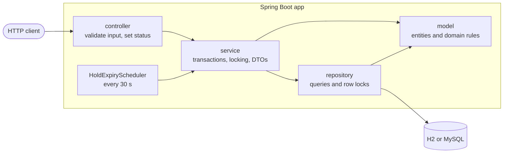
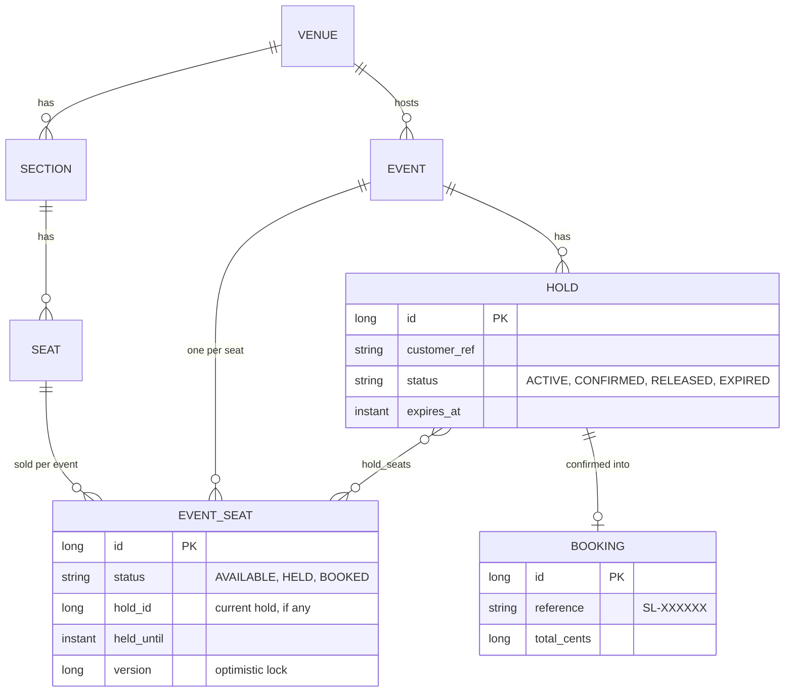
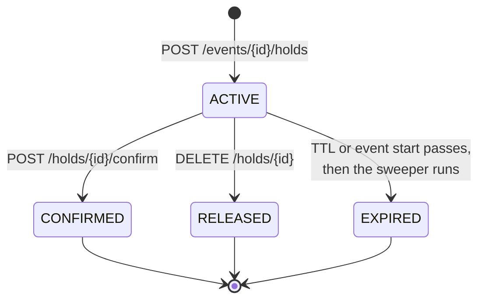
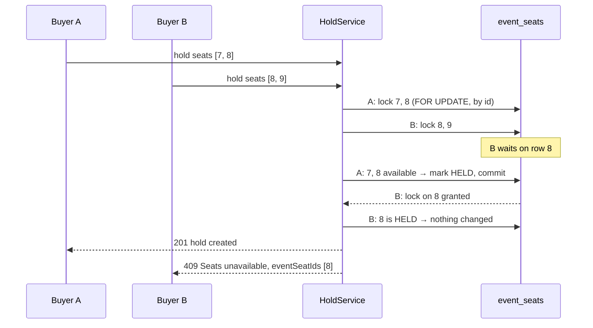
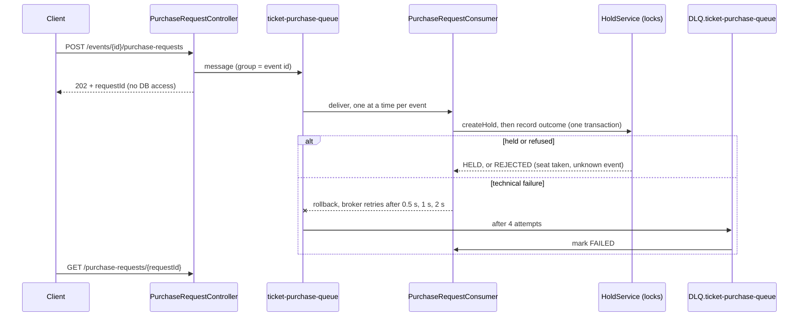

# SeatLock architecture

This guide explains how SeatLock is put together and why it can never sell one seat twice. For
endpoint details see [API.md](API.md); for setup see the [README](../README.md).

## Layers

| Layer | Package | Responsibility |
|---|---|---|
| Controller | `controller` | Validates the request (`@Valid`), calls one service method, sets status and `Location`. No logic. |
| Service | `service` | Owns transactions, takes locks in the right order, calls entity methods, returns DTO records. |
| Repository | `repository` | Spring Data interfaces, including the `FOR UPDATE` locking queries. |
| Model | `model` | JPA entities. Domain rules live here (`EventSeat.hold/book/releaseIfHeldBy`, `Hold.confirm/release/expire`). |
| DTO | `dto` | Request and response records. Entities never leave a service (`open-in-view` is off). |
| Errors | `exception` | Domain exceptions, mapped to RFC 9457 responses in `GlobalExceptionHandler`. |
| Queue | `queue` | Artemis queue names, retry and dead-letter policy, JSON messages, and `PurchaseRequestConsumer`. |
| Rate limit | `ratelimit` | `RateLimitingFilter`: a token bucket per client IP on the checkout paths; returns `429` before any controller runs. |

## Data model

- **Venue → Section → Seat** is the physical layout. It is shared by every event at the venue.
- **EventSeat** is the state of one seat for one event. This is the row that buyers compete for,
  and the only row that gets locked when seats change hands.
- **Hold** is a time-limited claim on a set of event seats. It stores the seat ids it covers.
- **Booking** is the confirmed result of exactly one hold (`hold_id` is unique).

## Hold lifecycle

The matching seat states:

| Hold becomes | Its seats become |
|---|---|
| `ACTIVE` | `HELD`, with `hold_id` and `held_until` set |
| `CONFIRMED` | `BOOKED` |
| `RELEASED` or `EXPIRED` | `AVAILABLE`, but only if they are still held by *this* hold |

A hold's expiry is `min(now + ttl, event.startsAt)`. Every terminal state is final;
`Hold.transitionTo` throws if you try to leave one.

## Concurrency design

### The rules

1. **Lock seats only through `EventSeatRepository.findAllByIdForUpdate`.** It runs
   `SELECT ... FOR UPDATE ... ORDER BY id`, so every transaction locks seats in ascending id order.
   Two requests with overlapping seats queue on the lowest shared id instead of deadlocking.
2. **Lock the hold before its seats.** Confirm, release and expiry call
   `HoldRepository.findByIdForUpdate` first. Creating a hold never locks another hold. So the
   global lock order is always *hold, then seats*.
3. **Check state only after the lock.** `isAvailableAt`, `isHeldBy` and the hold's status are read
   from the locked rows, never from an earlier unlocked read.
4. **`@Version` on `EventSeat` is a backstop.** If a stale write ever got through, it fails with
   `409 Concurrent update` instead of overwriting.
5. **Read time from the injected `Clock`,** never `Instant.now()`, so tests can move time.

### Two buyers, one seat

Because B only checks seat 8 after acquiring its lock, it always sees A's committed result.

### Expiry without races

- **Lazy expiry.** `EventSeat.isAvailableAt(now)` treats a `HELD` seat whose `held_until` has
  passed as available. New holds can take it at once, without waiting for cleanup.
- **The sweeper** (`HoldExpiryScheduler`, every `sweep-interval`) asks `HoldExpiryService` for up
  to `sweep-batch-size` lapsed `ACTIVE` holds. Each one is expired in its own short transaction:
  lock the hold, re-check it is still active and lapsed, lock its seats, and free only those still
  held by that hold (`releaseIfHeldBy`). A seat already re-held by a newer buyer is left alone.
- **Confirm vs. expiry.** Confirm locks the hold, rejects it with `410` if its time has passed,
  then locks the seats and checks each is still held by this hold. Whichever of confirm or the
  sweeper gets the hold lock first wins; the other sees a non-active hold and stops.

## Queued checkout

- **The queue changes when the database is hit, not how.** The consumer goes through
  `HoldService.createHold`, so the locking rules above apply unchanged, and consumers on several
  app instances stay safe.
- **One event at a time.** Messages carry `JMSXGroupID = event-{id}`, so Artemis delivers one
  event's requests in order to a single consumer, while different events are processed in
  parallel.
- **Outcome rows are the idempotency key.** `purchase_requests` uses the request id as its primary
  key and is written in the same transaction as the hold. A redelivered message that already has a
  row is skipped, so a crash between commit and acknowledgement never creates a second hold.
- **Business refusals are not retried.** `SeatUnavailableException`, `NotFoundException` and
  `InvalidRequestException` are recorded as `REJECTED` in a new transaction. Everything else is
  rethrown so the transacted JMS session rolls back and the broker redelivers.

## Configuration

| Property | Default | Meaning |
|---|---|---|
| `seatlock.holds.ttl` | `PT10M` | How long a hold lasts |
| `seatlock.holds.max-seats-per-hold` | `8` | Seat limit per hold |
| `seatlock.holds.sweep-interval` | `PT30S` | Delay between expiry sweeps |
| `seatlock.holds.sweep-batch-size` | `200` | Holds expired per sweep |
| `seatlock.holds.sweeper-enabled` | `true` | Turn the background sweeper off (tests do this) |
| `seatlock.rate-limit.enabled` | `true` | Per-IP rate limit on checkout (off in tests and load tests) |
| `seatlock.rate-limit.requests-per-second` | `5` | Checkout requests allowed per second per IP, also the burst size |
| `seatlock.rate-limit.paths` | `/api/events/*/holds`, `/api/events/*/purchase-requests`, `/api/holds/*/confirm` | Paths the limit applies to |
| `seatlock.queue.consumers` | `1-4` | Queue consumer threads (one event's requests are still processed one at a time) |
| `seatlock.queue.max-delivery-attempts` | `4` | Tries per queued request before it goes to the dead-letter queue |
| `seatlock.queue.redelivery-delay` | `PT0.5S` | Wait before the first retry |
| `seatlock.queue.redelivery-multiplier` | `2.0` | Growth of the wait on each further retry (0.5 s, 1 s, 2 s) |

Profiles: default uses in-memory H2 in MySQL mode; `mysql` points at MySQL 8 (see
`docker-compose.yml`); `demo` seeds a 5,000-seat venue and two events.

## Testing strategy

| Kind | Where | How |
|---|---|---|
| Entity rules | `src/test/.../model` | Plain unit tests, no Spring |
| HTTP mapping | `controller/HoldControllerTest` | `@WebMvcTest` with mocked services |
| End-to-end flow | `controller/ReservationFlowIntegrationTest` | Full app over MockMvc |
| Services and races | `src/test/.../service` | Full context on H2, extending `support/IntegrationTest` |

Integration tests are **not** `@Transactional`, because the race tests need real commits across
threads. Each test creates its own venue and event instead of cleaning up. Time is controlled with
`MutableClock.advance(...)`, and since the sweeper is disabled in tests, they call
`HoldExpiryService.expireLapsedHolds()` directly.

`ConcurrentHoldIntegrationTest` runs 200 threads at once in three races:

- **Same seats:** exactly one buyer must win.
- **Overlapping seats:** no seat may be held twice, and nothing may deadlock.
- **Mixed traffic:** buyers retry for 3 of the same 40 seats, then confirm, release or keep their
  hold, so create, confirm and release lock the same rows at the same time. Every seat must end
  in at most one confirmed or active hold, and the seat map must agree.

For load beyond the test suite, the Locust script in `load-test/` drives a running app over HTTP
with 500 virtual fans (see the README).

## Performance

- **Seat map reads columns, not entities.** `EventSeatRepository.findSeatMap` selects only the
  fields the map needs into `SeatMapRow` records. The "lapsed hold counts as available" rule is
  shared through the static `EventSeat.effectiveStatus(status, heldUntil, now)`, so it still lives
  on the entity.
- **gzip** is on for `application/json` and `application/problem+json` responses.
- **Connection pool:** the default 10 connections. Larger pools were measured and did not raise
  throughput, because contended holds wait on row locks rather than on connections.
